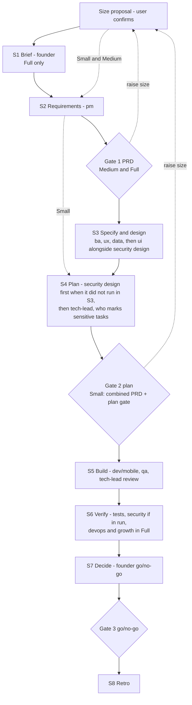

# Run Sizing and Live Progress - Plan

## Goal Capsule

- **Objective:** Make `/team` runs faster and always legible: right-size each run to the work, show progress in the chat after every step, and remove avoidable waiting from full runs.
- **Product authority:** The plugin owner (Mayur). The Product Contract is authoritative for behaviour; the Planning Contract for how it is built. Changes to gate count update `REQUIREMENTS.md` R5.
- **Execution profile:** Prompt and documentation edits only, in `plugins/product-team/`, `README.md` and `REQUIREMENTS.md`. No code and no new dependencies.
- **Stop conditions:** Stop and ask if a change would alter a safety rule, remove a gate from Medium or Full, or make the 13 Team protocol copies differ.
- **Open blockers:** None.

---

## Product Contract

### Summary

`/team` proposes a run size (Small, Medium or Full) from the idea and the repo, and the user confirms it before work starts.
After every step the coordinator prints a short status block in the chat: stage, what just finished, what is running, what is next, and task progress.
Full runs also get faster by running independent stages at the same time and giving each document a length target.

### Problem Frame

A `/team` run today always goes through all 13 roles and three gates, even for a small feature on an existing codebase.
Users found two things frustrating: the run takes too long, and while it runs they cannot tell what is happening.
The coordinator prints one line per finished step, so a role that works for ten minutes, or three roles running in parallel, produce long silences with no sense of stage, remaining work or what comes next.
The status exists in `.team/state.md` and `.team/board.md`, but only if the user goes and reads files written for agents.

### Key Decisions

- **The user confirms the size; the coordinator never picks silently.** One extra question at the start is cheaper than a run that skipped a role the user expected. (session-settled: user-approved — chosen over automatic sizing: avoids hidden gaps)
- **Progress lives in the chat, not a dashboard.** The status block is printed by the coordinator in the conversation. (session-settled: user-directed — chosen over a live web dashboard, notifications only, or both: the user wants it where they already look)
- **Speed comes from sizing plus cheap wins, not from rewriting the flow.** Spec-before-code and test-first QA stay. (session-settled: user-directed — chosen over build-first-document-later: it would break QA's spec-driven tests and add rework)
- **All roles keep the session model for now.** Cheaper models for document roles wait until evals can show quality holds. (session-settled: user-approved — chosen over model tiering now: protects document quality while fixing speed) Superseded by `docs/plans/2026-10-24-002-feat-role-model-tiers-plan.md`, which assigns models per role.
- **Small mode has two gates; Medium and Full keep three.** Small merges the PRD and plan approvals into one gate. (session-settled: user-approved — chosen over three gates everywhere: one less stop on small work)
- **Size can be raised only before the build, never lowered.** Raising is offered at Gate 1 and Gate 2 (Small's combined gate); at go/no-go the user starts a new run instead. Lowering would discard work already done. (session-settled: user-directed — chosen over raising at any gate with re-planning and rebuilding: avoids redoing built work)

### Requirements

**Run sizing**

- R1. On a new idea, before the brief stage, the coordinator proposes a size with a one-line reason drawn from the idea and the repo, lists the roles that size runs, and waits for the user to confirm or change it.
- R2. Small runs `pm`, `tech-lead`, `dev` or `mobile`, `qa`, and `founder` for the final go/no-go only.
- R3. Medium runs everything in Small plus `ba`, `security` (design and code review), and `ux` and `ui` when the product has a user interface.
- R4. Full runs all 13 roles, as today.
- R5. Regardless of size, `security` joins (design review and code review) when the work touches authentication, payments or personal data.
- R6. At confirmation the user can add or remove individual roles on top of the chosen size.
- R7. Small has one combined gate for the PRD and the plan, then the go/no-go gate; Medium and Full keep three gates.
- R8. The chosen size and role list are recorded in `.team/state.md`, so `/team resume`, `/team status` and `/role` respect them.
- R9. At Gate 1 or Gate 2 the user can raise the size; the coordinator runs the newly added roles, has `tech-lead` revise the plan if one exists, and shows the gate again.

**Progress in the chat**

- R10. After every step (a role finishes, a gate is reached, or a task changes status) the coordinator prints a status block.
- R11. The status block shows: run size, stage number and name out of the total for that size, what just finished with a one-line result, what is running now, what comes next, tasks done out of total with counts in review and blocked, and counts of open S1/S2 bugs and blocking questions.
- R12. The status block fits in about 8 lines; detail stays in the `.team/` files.
- R13. When roles start, the coordinator prints one line naming each role started and what it is producing.
- R14. `/team status` prints the same status block.
- R15. `/role` ends with a one-line task progress summary for the run.

**Leaner full runs**

- R16. Stages that do not depend on each other run at the same time, within `max_parallel`; at minimum the security design review runs alongside `ui` instead of after it.
- R17. Each document role has a length target for its deliverable, scaled to the run size, and trims its output to meet it.

### Acceptance Examples

- AE1. **Covers R1, R2, R5.** Given an existing web app and the idea "add password reset", when `/team` starts, then it proposes Small, and because the work touches authentication it adds `security` and says so in the proposal.
- AE2. **Covers R7.** Given a Small run, when `pm` and `tech-lead` finish, then the user sees one gate showing both the PRD summary and the plan, and no separate plan gate follows.
- AE3. **Covers R10, R11, R13.** Given a Full run where `ba`, `ux` and `data` start in parallel, when they start, the user sees one line naming all three; when `ux` finishes first, the user sees a status block showing `ux` done, `ba` and `data` still running, and `ui` next.
- AE4. **Covers R9.** Given a Small run at its combined PRD-and-plan gate, when the user asks for Medium, then `ba`, `security`, and `ux` and `ui` if the product has a UI, run; `tech-lead` revises the plan; and the gate is shown again. At the go/no-go gate, raising is not offered.

### Success Criteria

- At any moment during a run, the latest chat output tells the user the stage, who is working and what is next, without opening a file.
- A Small run on a feature for an existing codebase skips at least six role runs and one gate compared with today.
- A Full run has at least one fewer sequential step than today: security's design review no longer waits for `ui`.

### Scope Boundaries

- A live web dashboard or notifications for progress.
- Model tiering per role.
- Merging QA testing and code review into one pass.
- Building code before the spec is written.

### Follow-up Improvements for the Other Gaps

The review of all 13 agents and 4 commands found gaps beyond speed and visibility. Each is a separate piece of work after this plan.

| Gap | Improvement |
|---|---|
| Each role grades its own quality bar; the coordinator has no criteria to send weak work back | Give the coordinator a short checklist per deliverable, drawn from each role's quality bar, and send back any failing item. Add one cross-check per document: `pm` checks `spec.md` against the PRD, `qa` checks `plan.md` acceptance ids. |
| Safety rules are prompt text only | Ship plugin hooks that block, before they run, pushes to the default branch, force-pushes, reading `.env` files and known deploy commands. The rule then holds even if a model slips. |
| No way to test the plugin | Add a `claude plugin eval` suite: a small sample repo plus an idea, with checks on the `.team/` output (every Must story has acceptance criteria, the Won't list is non-empty, board statuses are valid). Run it before each release. |
| No model or cost control | After evals exist, set `model:` per role (a faster model for document roles, the strongest for `tech-lead` and `security`) and report token use per role at each gate. |
| Deliverable formats are prose-described | Add a skeleton template for each deliverable that roles fill in. Consistent shape also lets the status block read counts reliably. |
| Gate summaries are chat-only | Optionally publish each gate summary as a shareable page for teams that review together. |
| Team protocol is copied into 13 files | Add a CI check in this repository that fails when the 13 copies differ, so edits and team-wide lessons stay in sync. |
| Small inconsistencies | Write the development steps into `mobile` instead of pointing at `dev`'s practice it cannot see; add a QA rounds column to the board so round limits are tracked by the coordinator, not from memory. |
| Users don't know how to update | Add an "Updating" section and a changelog to the README, and bump `version` in `plugin.json` on every change. |

### Sources

- `plugins/product-team/commands/team.md` — stages S1-S8, the gate wording, and the current one-line-per-step progress rule.
- `plugins/product-team/commands/role.md` — the single-role flow that R8 and R15 touch.
- `REQUIREMENTS.md` — R4 (fixed role order) and R5 (three gates) change with this plan.

Product Contract preservation: changed R9, AE4 and the raise-size Key Decision (raising limited to Gates 1-2, confirmed by the user in review), and the third Success Criterion ("stage" corrected to "step"); the three deferred Outstanding Questions are resolved by KTD3, KTD4 and KTD5 and removed.

---

## Planning Contract

### Key Technical Decisions

- KTD1. **Two shared rules go into the Team protocol instead of per-agent edits.** "Inputs from roles outside this run's size are absent by design; work from what exists and don't ask for them" and "Keep your deliverable within the length target the coordinator gave you." All 13 copies stay byte-identical. One edit covers every role, and the coordinator owns the numbers.
- KTD2. **Small and Medium runs have no `brief.md`.** `pm` writes a three-line Problem section (who, problem, how we'll know) at the top of `prd.md`, and `founder` judges the go/no-go against the PRD's success metrics. This instantiates the Product Contract's Small role list (R2).
- KTD3. **Length targets are one word budget per size for narrative prose:** Small 400, Medium 800, Full 1500 words per document. Tables, diagrams, IDs and test scenarios don't count. They are starting values; `/retro` lessons tune them.
- KTD4. **Sensitive-area escalation is checked twice.** At sizing, from the idea and the repo. After the plan, from tasks that `tech-lead` marks `sensitive` (touching authentication, payments or personal data). Either trigger adds `security` to the run and says so in the status block. Escalation that depends on planning would otherwise be missed in Small runs. When the post-plan check adds `security`, it reviews the design and `tech-lead` adds its SEC requirements to the plan before the plan gate; code review follows in S6.
- KTD9. **Parallel roles start in the background.** Today `team.md` starts parallel roles as several Agent calls in one message, so the coordinator regains control only when all of them return. Background starts let each completion arrive on its own, which is what makes a status block per finished role possible.
- KTD5. **The only new overlap is security's design review alongside `ui`.** `growth` stays last because its copy must match what was built. Further overlaps wait for evidence from real runs.
- KTD6. **Stage numbering is per size.** Full has 8 stages, Medium 7 (no brief stage), Small 6 (no brief stage, and the specify-and-design stage is dropped). The status block always shows `stage n/N` for the run's own size.
- KTD7. **`/role` on a role outside the run asks the user whether to add it.** On yes it is added to the role list in `state.md`; on no it stops. That keeps parallel sessions consistent with the run's size.
- KTD8. **Version 0.3.0.** New behaviour and a changed gate count make this a minor bump.

### High-Level Technical Design

Stage flow per size. Dashed arrows show paths that only smaller sizes take, and the raise-size loop at Gates 1 and 2.



Status block shape (directional; exact wording is the implementer's):

```text
[Medium] Stage 2/7 - Specify and design
Done:    ux - 6 screens, all states covered
Running: ba (spec.md)
Next:    ui + security design review
Tasks:   0/0 done, 0 in review, 0 blocked | Bugs S1/S2: 0 | Blocking questions: 1
```

---

## Implementation Units

### U1. Shared protocol rules for missing inputs and length targets

- **Goal:** Every role works correctly when upstream files are absent and respects its length target.
- **Requirements:** R2, R3, R17; KTD1, KTD3.
- **Dependencies:** None.
- **Files:** `plugins/product-team/agents/*.md` (all 13, Team protocol section only).
- **Approach:** Add two numbered rules to the Team protocol, identical in all 13 files. Insert them after rule 2 (Lessons) and renumber the rest so the report format stays rule last.
- **Patterns to follow:** Existing protocol rule style: bold lead-in, one or two sentences.
- **Test scenarios:**
  - The Team protocol section hashes identically across all 13 agent files after the edit.
  - Each agent file still has exactly one `## Learned lessons` section, after the protocol.
- **Verification:** The protocol identity check in the Verification Contract passes.

### U2. Run sizing in `/team`

- **Goal:** `/team` proposes, records and applies a run size.
- **Requirements:** R1-R9, R16, R17; AE1, AE2, AE4; KTD3-KTD6; Key Decision on raising size before the build only.
- **Dependencies:** U1.
- **Files:** `plugins/product-team/commands/team.md`.
- **Approach:**
  - Add a size table (roles and stages per size) and the length-target table to the command.
  - In setup, add a sizing step after the workspace is created and before S1: read the idea and the repo, propose a size with a one-line reason, list the roles, apply the sensitive-area rule, and wait for confirmation or role changes.
  - Record size, role list and stage total in `state.md`; `resume` and `status` read them.
  - Make each stage skip roles outside the run. Medium skips S1; Small skips S1 and S3 and shows one combined gate after S4.
  - When `security` is in the run: in S3 its design review starts alongside `ui`; when S3 or `ui` doesn't run, it runs at the start of S4, before `tech-lead`, as today.
  - After S4, add `security` if `tech-lead` marked any task `sensitive` and it isn't already in the run; it reviews the design and `tech-lead` adds its SEC requirements to the plan before the plan gate (KTD4).
  - At Gate 1 and Gate 2, offer raising the size; on a raise, run the added roles, have `tech-lead` revise the plan if one exists, and show the gate again. Don't offer raising at go/no-go.
  - Pass the size's length target in every document role's prompt.
  - Update the "three approval gates" wording in the command's description and opening paragraph to say gates depend on size.
- **Patterns to follow:** The existing `## 0. Choose the mode` and gate blockquote style in `team.md`.
- **Test scenarios:**
  - Covers AE1. Idea "add password reset" in a repo with existing auth: the proposal is Small with `security` added, and the reason names authentication.
  - Covers AE2. A Small run reaches one gate showing the PRD and the plan together; no separate plan gate follows.
  - Covers AE4. Raising Small to Medium at the combined gate runs `ba`, `security`, and `ux`/`ui` when there is a UI; `tech-lead` revises the plan; the gate is shown again. The go/no-go gate offers no raise.
  - Covers AE1. A Small run with `security` added at sizing runs the design review before `tech-lead`, and `plan.md` contains its SEC requirements.
  - A Full run still has three gates and runs all 13 roles (`ux` and `ui` skipped only without a UI).
  - `/team resume` on a Small run does not start `ba`, `ux`, `ui`, `data`, `devops` or `growth`.
  - A Small run where `tech-lead` marks a task `sensitive` adds `security` before the build stage.
- **Verification:** A dry run of each scenario on a sample repo produces the described stages and gates.

### U3. Status block in the chat

- **Goal:** The user always sees where the run is.
- **Requirements:** R10-R14; AE3; KTD6, KTD9.
- **Dependencies:** U2.
- **Files:** `plugins/product-team/commands/team.md`.
- **Approach:**
  - In "How to start a role", start parallel roles as background agents instead of several Agent calls in one message. Handle each completion as it arrives: record its outputs, update the board and `state.md`, then print the status block (KTD9).
  - Define the status block once in `team.md` (fields from R11, about 8 lines).
  - Replace the current "one line per finished step" rule. Print a one-line notice when roles start, and the status block after each role finishes, each gate and each task status change.
  - Make `/team status` print the same block, followed by the details it already lists.
- **Patterns to follow:** The existing `status` mode in `team.md`, which already gathers counts from the board, bugs and questions.
- **Test scenarios:**
  - Covers AE3. Three parallel roles start: one start line names all three. When the first finishes, its block appears while the other two are still running, showing them as running and the correct next step.
  - The block shows `Stage n/N` with N = 6, 7 or 8 for Small, Medium or Full.
  - Task counts in the block match the board after a task moves to `review` and then `done`.
  - `/team status` prints the block without changing any file.
- **Verification:** During a dry run, every step is followed by a block and no block exceeds about 8 lines.

### U4. Role adjustments for smaller runs and sensitive tasks

- **Goal:** `pm`, `founder` and `tech-lead` behave correctly in Small and Medium runs.
- **Requirements:** R2, R5; KTD2, KTD4.
- **Dependencies:** U1.
- **Files:** `plugins/product-team/agents/pm.md`, `plugins/product-team/agents/founder.md`, `plugins/product-team/agents/tech-lead.md`.
- **Approach:**
  - `pm`: when there is no `brief.md`, start the PRD with a Problem section (who, problem, success signal) taken from `idea.md` and the codebase.
  - `founder`: when there is no brief, judge go/no-go against the PRD's Problem section and success metrics.
  - `tech-lead`: add a `sensitive` column to the `plan.md` task table, marked `yes` for tasks touching authentication, payments or personal data.
  - Edit only the role-specific sections, never the Team protocol.
- **Patterns to follow:** Each agent's existing "How you work" and "Go/no-go" sections.
- **Test scenarios:**
  - A Small run's `prd.md` opens with a Problem section, and no `brief.md` is created.
  - `go-no-go.md` in a Small run cites the PRD's success metrics as its evidence.
  - A plan for "add password reset" marks the reset tasks `sensitive`.
- **Verification:** The protocol identity check still passes after these edits.

### U5. `/role` respects the run's size

- **Goal:** Single-role sessions follow the run's role list and report progress.
- **Requirements:** R8, R15; KTD7.
- **Dependencies:** U2, U3.
- **Files:** `plugins/product-team/commands/role.md`.
- **Approach:**
  - After resolving the role, read the size and role list from `state.md`. If the role isn't in the run, ask whether to add it; on yes record it, on no stop.
  - For document roles, include the run size's length target (the table in `team.md`, KTD3) in the role's prompt.
  - End the report with one line of task progress: done out of total, in review, blocked.
- **Patterns to follow:** The existing four-line report at the end of `role.md`.
- **Test scenarios:**
  - `/role ux` in a Small run asks to add `ux`; answering no changes nothing.
  - `/role pm` in a Small run passes the Small length target, and the PRD's prose stays within it.
  - `/role dev next` in any run ends with a progress line matching the board.
- **Verification:** Dry run of both scenarios.

### U6. Documentation and version

- **Goal:** Users and maintainers can see and adopt the new behaviour.
- **Requirements:** All; KTD8.
- **Dependencies:** U1-U5.
- **Files:** `README.md`, `REQUIREMENTS.md`, `plugins/product-team/.claude-plugin/plugin.json`, `.claude-plugin/marketplace.json`.
- **Approach:**
  - marketplace.json: change "Three approval gates" in the plugin description to say gates depend on run size.
  - README: add a "Run sizes" section with the role table and gates per size, show the status block in Quick start, and update "How they talk".
  - REQUIREMENTS: update R4 and R5 for sizes, and add rows for run sizing and progress visibility.
  - Bump `version` to 0.3.0.
- **Test expectation:** None. Documentation and metadata only.
- **Verification:** `plugin.json` parses as JSON, and the README's size table matches `team.md`.

---

## Verification Contract

There is no test suite; verification is mechanical checks plus a dry run.

| Gate | How | Applies to |
|---|---|---|
| Protocol identity | Hash the Team protocol section (from `## Team protocol` up to `## Learned lessons`) of all 13 agent files; all hashes must match | U1, U4 |
| Manifest validity | `plugin.json` and `.claude-plugin/marketplace.json` parse as JSON | U6 |
| Dry run | Install the plugin from this checkout in a scratch repo and run `/team` on a small feature (expect Small), a feature with screens (expect Medium) and a new product idea (expect Full), checking the U2, U3 and U5 scenarios | U2, U3, U4, U5 |

---

## Definition of Done

- Every requirement R1-R17 is implemented in the files named by its units.
- All three verification gates pass, and the dry run shows the status block after every step.
- `README.md`, `REQUIREMENTS.md` and `plugin.json` (0.3.0) describe the new behaviour.
- No abandoned or experimental edits remain in the diff.
