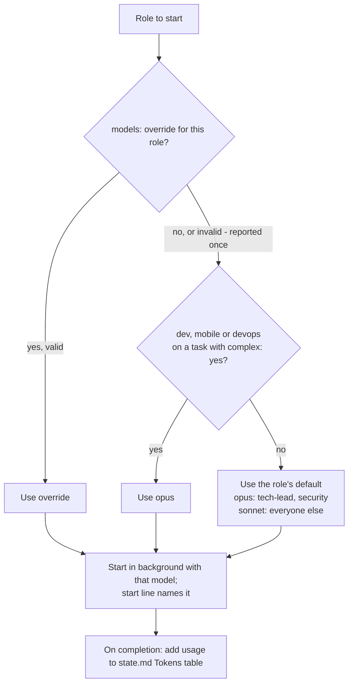

# Role Model Tiers - Plan

## Goal Capsule

- **Objective:** Spend tokens where judgement matters: run each role on the Claude model its work needs, let projects override it, and show token use so the savings are visible.
- **Product authority:** The plugin owner (Mayur). This supersedes the "all roles keep the session model" Key Decision in `docs/plans/2026-10-24-001-feat-run-sizing-and-progress-plan.md`. The Product Contract is authoritative for behaviour; the Planning Contract for how it is built.
- **Execution profile:** Prompt, frontmatter and documentation edits in `plugins/product-team/`, `README.md` and `REQUIREMENTS.md`. Builds on branch `feat/run-sizing-and-progress`.
- **Stop conditions:** Stop and ask if a change would alter a safety rule or make the 13 Team protocol copies differ.
- **Open blockers:** None.

---

## Product Contract

### Summary

Every role has a default Claude model: Opus for `tech-lead` and `security`, Sonnet for the document roles, and Opus or Sonnet per task for the code-writing roles, decided by a `complex` flag that `tech-lead` sets in the plan.
A project can override any role's model in `.team/config.yaml`.
The start line names each role's model, and each gate reports token use per role and per model.

### Problem Frame

Today every agent runs on whatever model the user's session uses.
A session on Opus pays Opus prices for work that a cheaper model does equally well, such as structured documents and routine code against a precise plan.
A session on a cheaper model gets that model for the work where judgement matters most: architecture, code review and security.
The user has no way to see how many tokens each role spends, so there is no evidence for tuning.

### Key Decisions

- **Code-writing roles choose the model per task.** `tech-lead` marks each task `complex: yes/no`; `dev`, `mobile` and `devops` run on Opus for complex tasks and Sonnet otherwise. (session-settled: user-directed — chosen over Opus for all code, Sonnet-first with escalation, or both combined: hard tasks get Opus while routine work saves tokens)
- **Defaults live in the plugin; projects override them.** (session-settled: user-directed — chosen over fixed models, size-dependent models, or asking every run: one simple rule that stays tunable)
- **Model and token use are shown to the user.** (session-settled: user-directed — chosen over showing the model only or nothing: the user needs evidence that tokens are saved)
- **Roles name model families, not pinned versions.** `opus` and `sonnet` follow new releases automatically. This is an assumption the user accepted in review.
- **The coordinator stays on the session model.** Model defaults apply to roles it starts, not to the `/team` or `/role` session itself.

### Requirements

**Default models**

- R1. `tech-lead` and `security` default to Opus.
- R2. `founder`, `pm`, `ba`, `ux`, `ui`, `data`, `growth` and `qa` default to Sonnet.
- R3. `dev`, `mobile` and `devops` run on Opus for tasks marked `complex: yes` and on Sonnet otherwise, including work outside a planned task.
- R4. `tech-lead` marks every task in the plan `complex: yes` or `no`, with a short reason for `yes` (for example concurrency, data migration, large refactor, performance-critical, or an area the plan couldn't specify precisely).

**Overrides**

- R5. A project can set any role's model in `.team/config.yaml`; an override replaces the default and the `complex` rule for that role.
- R6. An invalid override (unknown role or unknown model) is reported once and ignored; the run never stops for it.
- R7. `/team` and `/role` apply the same defaults and overrides.

**Visibility**

- R8. The start line names each role's model, for example `Started: ba (spec.md, sonnet), tech-lead (plan.md, opus)`.
- R9. Each gate shows tokens used so far per role and per model; the go/no-go gate also shows the run total.
- R10. Token counts are recorded in `.team/state.md` so they survive `/team resume`; a role whose usage wasn't reported counts as unknown, not zero.

### Acceptance Examples

- AE1. **Covers R1-R4, R8.** Given a plan with T1 `complex: no` and T2 `complex: yes` (data migration), when both build tasks start, then the start line shows `dev` on sonnet for T1 and on opus for T2.
- AE2. **Covers R5.** Given `.team/config.yaml` with `models: { dev: opus }`, when any build task starts, then `dev` runs on Opus whatever the task's `complex` flag.
- AE3. **Covers R6.** Given `models: { reviewer: opus }`, when `/team` starts, then it reports that `reviewer` is not a role and continues with the defaults.
- AE4. **Covers R9, R10.** Given a run resumed after Gate 1, when Gate 2 is shown, then token use includes the roles that ran before the resume.

### Success Criteria

- On a Full run whose session is on Opus, fewer than half of the roles' tokens are spent on Opus (the coordinator session itself is not measured).
- The token report at go/no-go lets the user compare two runs and decide an override without opening any file.

### Scope Boundaries

- Moving a struggling task up to Opus automatically after failed QA or review rounds.
- Haiku for any role.
- Quality evals that compare models per role.
- Choosing models by run size.

### Dependencies / Assumptions

- Claude Code agent definitions accept a `model` setting, and the Agent tool accepts a per-call model that takes precedence over it (confirmed in this session's tool definitions).
- Background agents report token usage on completion (observed in this session); whether foreground agents report it too is unverified, which is why R10 allows "unknown".

### Sources

- `plugins/product-team/agents/*.md` — agent frontmatter, where per-role defaults live.
- `plugins/product-team/commands/team.md` — start line, status block, gates and the `config.yaml` template.
- `plugins/product-team/commands/role.md` — single-role starts that R7 covers.
- `plugins/product-team/agents/tech-lead.md` — the plan table that gains the `complex` column next to `sensitive`.

Product Contract preservation: changed the first Success Criterion to measure roles' tokens only, because the coordinator session's own usage is not reported (doc review).

---

## Planning Contract

### Key Technical Decisions

- KTD1. **Defaults live in each agent's frontmatter `model:` field, mirrored by a table in `team.md`.** Frontmatter applies whenever an agent starts, including outside `/team`; the table lets the coordinator name the model in the start line and resolve overrides. A verification gate keeps the two equal. Having the coordinator read agent files instead was rejected: the plugin's install path isn't reliably known from inside a command.
- KTD2. **One resolution rule, used by `/team` and `/role`:** a `models:` override for the role wins; otherwise `dev`, `mobile` or `devops` on a task marked `complex: yes` gets `opus`; otherwise the role's default. The coordinator passes the resolved model on every Agent call, so an override always beats frontmatter. Instantiates the Key Decisions on per-task code models and plugin defaults with overrides. (session-settled: user-directed — chosen over Opus for all code, Sonnet-first escalation, fixed models, size-based models or asking every run)
- KTD3. **Allowed override values are `opus` and `sonnet`.** Anything else, including `haiku`, is reported once and the default is used (R6). (session-settled: user-directed — chosen over also allowing `haiku` and `inherit`: matches the scoped models and needs no runtime resolution)
- KTD4. **Every role starts in the background, single roles included.** Background completions carry token usage; foreground calls may not. The coordinator ends its turn and waits, as it already does for parallel roles. (session-settled: user-approved — chosen over leaving single roles in the foreground: complete token counts)
- KTD5. **Fix rounds keep the task's model.** A QA or review fix for a task uses the model resolved for that task; there is no automatic upgrade.
- KTD6. **Token counts are an append-only `## Tokens` table in `state.md`:** one row per completed role start (role, model, task id, total tokens from the usage report, or `unknown`). Rows are only appended, like `log.md`, so parallel `/role` sessions never conflict. Gates compute per-role and per-model sums from it and show unknowns as `(+n unknown)` next to the known number. Totals cover roles only, not the coordinator session.
- KTD7. **Version 0.4.0.** New behaviour; minor bump.

### High-Level Technical Design

Model resolution for each role start:

---

## Implementation Units

### U1. Default models in agent frontmatter

- **Goal:** Each agent declares its default model.
- **Requirements:** R1, R2, R3; KTD1.
- **Dependencies:** None.
- **Files:** `plugins/product-team/agents/*.md` (frontmatter only).
- **Approach:** Add `model: opus` to `tech-lead` and `security`, and `model: sonnet` to the other 11, including `dev`, `mobile` and `devops`.
- **Test scenarios:**
  - Every agent file has exactly one `model:` line in its frontmatter, with the value listed above.
  - The Team protocol section still hashes identically across all 13 files.
- **Verification:** The frontmatter/table consistency gate passes (after U3).

### U2. `complex` flag in the plan

- **Goal:** `tech-lead` marks which tasks need the stronger model.
- **Requirements:** R4.
- **Dependencies:** None.
- **Files:** `plugins/product-team/agents/tech-lead.md`.
- **Approach:** Add a `complex` column to the `plan.md` table after `sensitive`, `yes` with a short reason or `no`, and list what counts: concurrency, data migration, large refactor, performance-critical work, or an area the plan couldn't specify precisely.
- **Patterns to follow:** The `sensitive` column rule already in `tech-lead.md`.
- **Test scenarios:**
  - A plan for "add a data export with a schema migration" marks the migration task `complex: yes (data migration)`.
  - A plan with only copy and UI tweaks marks every task `complex: no`.
- **Verification:** Dry run produces a plan with the column filled for every task.

### U3. Model resolution and overrides in `/team`

- **Goal:** `/team` starts every role on the resolved model and names it.
- **Requirements:** R3, R5, R6, R7, R8; AE1, AE2, AE3; KTD2, KTD3, KTD4, KTD5.
- **Dependencies:** U1, U2.
- **Files:** `plugins/product-team/commands/team.md`.
- **Approach:**
  - Add a "Models" subsection to section 1: the default table (matching U1), the resolution rule, allowed override values, and that fix rounds keep the task's model.
  - Add a commented `models:` example to the `config.yaml` template, and validate overrides during setup (known role, value `opus` or `sonnet`), reporting invalid entries once.
  - Read a build task's `complex` value from `.team/plan.md` by task id, at S5 step 2 and for every fix round; the board does not carry it.
  - In "How to start a role", pass the resolved model on every Agent call and start every role in the background, then end the turn and wait.
  - Extend the start-line format to `<role> (<file>, <model>)`.
- **Patterns to follow:** The `names.yaml` validation rule (report and ignore, never stop).
- **Test scenarios:**
  - Covers AE1. T1 `complex: no` and T2 `complex: yes` start together: the start line shows `dev (T1, sonnet)` and `dev (T2, opus)`.
  - Covers AE2. `models: { dev: opus }` makes every `dev` start show `opus`, whatever the flag.
  - Covers AE3. `models: { reviewer: opus }` is reported once at setup; the run continues on defaults.
  - `models: { ba: gpt-5 }` and `models: { ba: haiku }` are each reported as unknown models; `ba` uses `sonnet`.
  - A QA fix round on T2 starts `dev` on `opus` again.
- **Verification:** Dry run shows the expected models in start lines for all three cases.

### U4. Token reporting in `/team`

- **Goal:** The user sees token use per role and per model at every gate.
- **Requirements:** R9, R10; AE4; KTD6.
- **Dependencies:** U3.
- **Files:** `plugins/product-team/commands/team.md`.
- **Approach:**
  - Add the append-only `## Tokens` table (role, model, task id, tokens) to `state.md`, one row appended per completion with the total token count from its usage report.
  - At Gates 1 and 2, show tokens per role and a per-model total; at go/no-go, also the run total and the share spent on Opus.
  - `/team status` shows the same token summary.
- **Test scenarios:**
  - Covers AE4. After a resume past Gate 1, Gate 2's totals include the roles that ran before the resume.
  - A completion with no usage appends an `unknown` row; the gate shows that role's known sum followed by `(+1 unknown)`, and the Opus share uses known tokens only.
  - The go/no-go report states that totals cover the roles, not the coordinator session.
  - Go/no-go shows the Opus share as a percentage of known tokens.
- **Verification:** Dry run gates show token tables whose sums match the per-role rows.

### U5. `/role` uses the same rule

- **Goal:** Single-role sessions pick models and record tokens the same way.
- **Requirements:** R7, R8, R10; KTD2, KTD4.
- **Dependencies:** U3, U4.
- **Files:** `plugins/product-team/commands/role.md`.
- **Approach:** Resolve the model with the rule in `team.md`: overrides from `config.yaml`, then the task's `complex` flag read from `.team/plan.md` by task id (`no` for free-text work), then the default. Name it in the report, start the role in the background and wait, run the after-return steps on the completion, and append its usage row to `## Tokens`.
- **Test scenarios:**
  - `/role dev T2` on a `complex: yes` task starts on `opus`.
  - `/role pm next` with `models: { pm: opus }` starts on `opus`.
  - After `/role dev T1`, `state.md`'s Tokens table has a `dev | sonnet` row with its usage.
- **Verification:** Dry run of the three scenarios.

### U6. Documentation and version

- **Goal:** Users can see and change the models.
- **Requirements:** All; KTD7.
- **Dependencies:** U1-U5.
- **Files:** `README.md`, `REQUIREMENTS.md`, `plugins/product-team/.claude-plugin/plugin.json`.
- **Approach:** Add a "Model per role" section to the README (default table, `complex` rule, `models:` override, token report), add `models:` to the README config block, add R15 to `REQUIREMENTS.md`, and bump to 0.4.0.
- **Test expectation:** None. Documentation and metadata only.
- **Verification:** The README table matches U1's frontmatter, and `plugin.json` parses.

---

## Verification Contract

| Gate | How | Applies to |
|---|---|---|
| Model consistency | Each agent's frontmatter `model:` matches the default table in `team.md` and the README | U1, U3, U6 |
| Protocol identity | The 13 Team protocol sections hash identically | U1, U2 |
| Manifest validity | `plugin.json` and `.claude-plugin/marketplace.json` parse as JSON | U6 |
| Dry run | In a scratch repo, run `/team` on a feature with one migration task and `models: { ba: opus, reviewer: opus }`; check start lines, the override warning and gate token tables; then run `/role dev T<n>` | U2-U5 |

---

## Definition of Done

- R1-R10 are implemented in the files named by their units.
- All verification gates pass; the dry run shows models in start lines and token tables at gates.
- README, REQUIREMENTS and `plugin.json` (0.4.0) describe the new behaviour.
- No abandoned or experimental edits remain in the diff.
